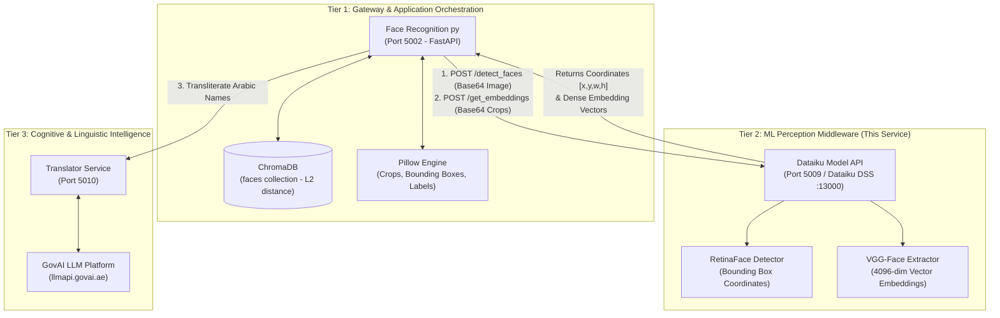
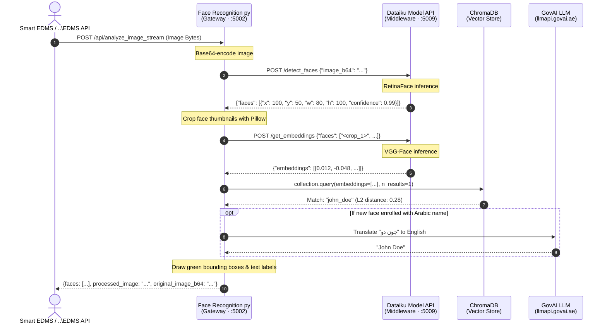

# Dataiku Model API — Architecture & System Design

This API is the **stateless machine learning perception engine** for face detection and dense vector representation in the Smart EDMS ecosystem. It isolates deep neural network computation (TensorFlow, RetinaFace, VGG-Face) from application logic.

---

## 1. System Overview & The Three-Tier AI Pipeline

In the Smart EDMS architecture, **Dataiku Model API** serves as the **ML Perception Middleware** bridging the application gateway ([Face Recognition py](file:///d:/projects/new%20EDMS%20py/Face%20Recognition%20py)) with cognitive enterprise services (**GovAI LLM**):



---

## 2. What This API Does vs. What It Does NOT Do

### What This API Does
| Responsibility | Details |
|---|---|
| **Facial Detection** | Uses RetinaFace deep neural network to locate faces and return bounding box coordinates `[x, y, w, h]` and confidence scores. |
| **Dense Vector Embeddings** | Computes high-dimensional feature representations (4096-dimensional vectors) via VGG-Face. |
| **Offline Model Bootstrapping** | Pre-loads local `.h5` model weights (`vgg_face_weights.h5`, `retinaface.h5`) into the DeepFace cache during startup. |
| **Stateless Concurrency** | Processes all requests in-memory using Waitress WSGI with 100 worker threads. |

### What This API Does NOT Do
| Responsibility | Handled By |
|---|---|
| **Store Face Images or Thumbnails** | `Face Recognition py` (Gateway) |
| **Maintain Vector Databases** | `Face Recognition py` (ChromaDB `faces` collection) |
| **Draw Visual Annotations / Bounding Boxes** | `Face Recognition py` (Pillow engine) |
| **Bilingual Name Translation** | `GovAI LLM` (via Translator Service) |
| **Direct Client / EDMS Ingestion** | `Face Recognition py` (FastAPI endpoints) |

---

## 3. Data Flow: Full Pipeline Interaction



---

## 4. Endpoints & Interface Contract

### `POST /detect_faces`
Receives a Base64-encoded image and returns an array of detected face boxes.

* **Request**:
  ```json
  { "image_b64": "<base64_string>" }
  ```
* **Response**:
  ```json
  {
    "faces": [
      { "index": 1, "x": 100, "y": 50, "w": 80, "h": 100, "confidence": 0.99 }
    ]
  }
  ```

---

### `POST /get_embeddings`
Computes mathematical vector representations for an array of pre-cropped face images.

* **Request**:
  ```json
  {
    "faces": [
      "<base64_crop_1>",
      "<base64_crop_2>"
    ]
  }
  ```
* **Response**:
  ```json
  {
    "embeddings": [
      [0.0124, -0.0481, 0.0921, "... (4096 floats) ..."],
      null
    ]
  }
  ```

---

### `GET /health`
Readiness and liveness probe for monitoring tools and load balancers.

* **Response**:
  ```json
  {
    "status": "ok",
    "service": "Dataiku Model API (Stateless)"
  }
  ```

---

## 5. Deployment Topology

1. **Local Windows Server (IIS / Waitress)**:
   - Configured via `web.config` with `HttpPlatformHandler`.
   - Runs `dataiku_model_api.py` served by Waitress with 100 threads on port `5009`.
2. **Enterprise Dataiku DSS API Deployer**:
   - The same endpoint logic is deployed as a managed service on Dataiku DSS (`https://dataiku-model-api.example.com:13000`).
   - The gateway (`Face Recognition py`) automatically unwraps Dataiku Deployer envelopes (`{"response": ..., "timing": ...}`).
