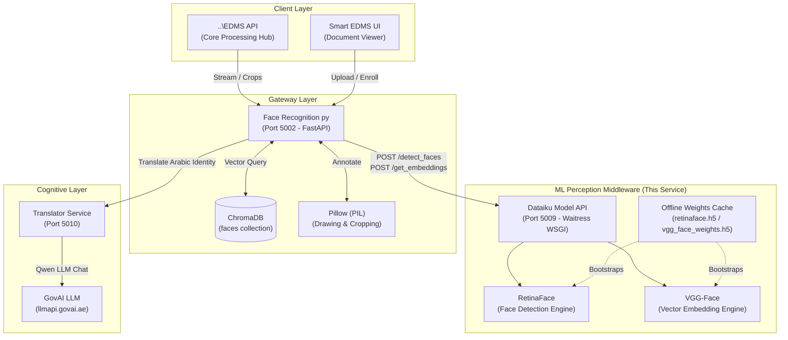

# 🧠 Dataiku Model API (Stateless Face & ML Perception Middleware)

> **High-Throughput Deep Learning Perception Engine & Middleware for the RTA Smart EDMS Ecosystem**  
> Powered by **Python / Flask**, **Waitress WSGI (100 Threads)**, **DeepFace**, **RetinaFace**, **TensorFlow**, and **VGG-Face**.

---

## 📑 Table of Contents

1. [Executive Summary & Architectural Role](#1-executive-summary--architectural-role)
2. [The Middleware Role: Bridging Face Recognition Gateway & GovAI LLM](#2-the-middleware-role-bridging-face-recognition-gateway--govai-llm)
3. [System Architecture & System Division](#3-system-architecture--system-division)
4. [Deep Learning Models & Vector Mathematics](#4-deep-learning-models--vector-mathematics)
5. [Connection with `Face Recognition py`](#5-connection-with-face-recognition-py)
6. [API Endpoints Reference](#6-api-endpoints-reference)
7. [Codebase Structure & Module Directory](#7-codebase-structure--module-directory)
8. [Configuration & Environment Variables](#8-configuration--environment-variables)
9. [Offline Setup & IIS Production Deployment](#9-offline-setup--iis-production-deployment)
10. [Health Probes & Operational Monitoring](#10-health-probes--operational-monitoring)

---

## 1. Executive Summary & Architectural Role

The **Dataiku Model API** is the dedicated, high-throughput machine learning inference engine for face detection and dense vector representation within the **RTA Smart EDMS** ecosystem.

Originally part of a monolithic architecture where heavy deep learning frameworks were bundled into web gateways, this service extracts neural network computation into an isolated, **100% stateless computing node**.

### Core Tenets of the Design
* **Pure Stateless Execution**: Never stores face images, thumbnails, or personal identities to disk. It receives Base64 image payloads in memory, computes bounding boxes or vector arrays, and immediately purges pixel buffers from memory.
* **Offline & Air-Gapped Ready**: Bootstraps pre-downloaded model weight files (`vgg_face_weights.h5`, `retinaface.h5`) into the DeepFace model cache during initialization, eliminating runtime internet dependencies.
* **High-Concurrency Serving**: Powered by the **Waitress** WSGI production server with 100 dedicated worker threads, ensuring rapid non-blocking inference under concurrent loads.
* **Flexible Deployment Topology**: Functions both as a standalone local Windows microservice (IIS / Waitress on port `5009` or `5003`) and as the reference model API deployed within enterprise **Dataiku DSS** (`https://dataiku-model-api.example.com:13000`).

---

## 2. The Middleware Role: Bridging Face Recognition Gateway & GovAI LLM

In the Smart EDMS artificial intelligence architecture, **Dataiku Model API** functions as the **ML & Vector Perception Middleware** connecting the gateway layer ([Face Recognition py](file:///d:/projects/new%20EDMS%20py/Face%20Recognition%20py)) with the cognitive layer (**GovAI LLM**):

```
┌────────────────────────────────────────────────────────────────────────────────────────────────────────┐
│ TIER 1: GATEWAY & APPLICATION ORCHESTRATION                                                            │
│ Face Recognition py (Port 5002)                                                                        │
│ • Ingestion: Raw byte streams & multipart form uploads from ..\EDMS API and Smart EDMS UI              │
│ • Image Engine: Pillow (PIL) crops face crops, draws green bounding boxes, renders typography labels    │
│ • Vector Database: Persistent ChromaDB instance indexing identities with Euclidean L2 distance        │
│ • Business Logic: Handles user enrollment, deletions, document abstract updates, and tagging queues    │
└───────────────────────────────────────────────────┬────────────────────────────────────────────────────┘
                                                    │
                                                    │ 1. Raw Images & Pre-Cropped Faces
                                                    │    (Base64 JSON Payloads)
                                                    ▼
┌────────────────────────────────────────────────────────────────────────────────────────────────────────┐
│ TIER 2: ML & VECTOR PERCEPTION MIDDLEWARE (THIS SERVICE)                                               │
│ Dataiku Model API (Port 5009 / Dataiku DSS :13000)                                                     │
│ • Perception Engine: RetinaFace deep convolutional facial detection (coordinates & confidence)         │
│ • Vector Extraction: VGG-Face deep representation generating 4096-dimensional dense embedding vectors  │
│ • Privacy & Compliance: 100% stateless execution — zero image retention, vectors & coordinates only    │
│ • Isolation: Shields both the gateway and the LLM from heavy TensorFlow / CUDA CPU & GPU loads        │
└───────────────────────────┬─────────────────────────────────────────────────┬──────────────────────────┘
                            │                                                 │
                            │ 2. Facial Coordinates                           │ 3. Dense Embeddings
                            │    & Detection Confidence                       │    (Feature Vectors)
                            ▼                                                 ▼
┌─────────────────────────────────────────────────────────┐     ┌────────────────────────────────────────┐
│ Downstream Multimodal Intelligence                      │     │ Identity Disambiguation & Resolution   │
│ (Video Context Summarizer & OCR)                        │     │ (ChromaDB Vector Matching in Gateway)  │
└───────────────────────────┬─────────────────────────────┘     └───────────────────┬────────────────────┘
                            │                                                       │
                            │                                                       │ 4. Non-ASCII / Arabic
                            │                                                       │    Identities
                            ▼                                                       ▼
┌────────────────────────────────────────────────────────────────────────────────────────────────────────┐
│ TIER 3: COGNITIVE & LINGUISTIC REASONING                                                               │
│ GovAI LLM Platform (https://llmapi.govai.ae) & Translator Microservice (:5010)                        │
│ • Bilingual Normalization: Normalizes Arabic VIP names (e.g., "جون دو" ➔ "John Doe")     │
│ • Multilingual Tagging: Eliminates duplicate entity representations across Arabic and English portals   │
│ • Semantic Contextualization: Fuses identified VIPs into document abstracts and video summaries       │
└────────────────────────────────────────────────────────────────────────────────────────────────────────┘
```

### Why a Dedicated Perception Middleware is Essential

1. **Decoupling Compute from Cognition**:
   Large Language Models (GovAI LLM) are masters of natural language reasoning, bilingual translation, and semantic summarization, but cannot natively execute low-level pixel convolution or dense facial vector extraction without massive compute latency. `Dataiku Model API` bridges this divide by transforming raw imagery into structured spatial (`[x, y, w, h]`) and mathematical (`vector[4096]`) abstractions.
2. **Standardized Facial Signatures for Bilingual Resolution**:
   When an individual's face is extracted by `Dataiku Model API`, the resulting vector is invariant to the user's interface language. `Face Recognition py` matches the vector in ChromaDB and leverages GovAI LLM to translate any Arabic transliterations into standardized English keys, ensuring that whether a document is ingested in Arabic or English, the VIP identity remains unified across the entire Smart EDMS database.
3. **Hardware & Process Isolation**:
   TensorFlow and Keras allocate significant virtual memory and process locks for GPU/CPU acceleration. By isolating model weights within `Dataiku Model API`, the FastAPI gateway ([Face Recognition py](file:///d:/projects/new%20EDMS%20py/Face%20Recognition%20py)) remains ultra-lean, responsive, and resilient to IIS worker recycling.

---

## 3. System Architecture & System Division



### Responsibility Matrix

| Feature / Responsibility | Dataiku Model API (Middleware) | Face Recognition py (Gateway) | GovAI LLM (Cognitive Layer) |
|:---|:---:|:---:|:---:|
| **Face Detection (RetinaFace)** | ✅ **Yes** | ❌ No | ❌ No |
| **Vector Embedding Generation (VGG-Face)** | ✅ **Yes** | ❌ No | ❌ No |
| **Offline Model Weights Bootstrapping** | ✅ **Yes** | ❌ No | ❌ No |
| **HTTP Image Stream Handling** | ❌ No | ✅ **Yes** | ❌ No |
| **Pillow Cropping & Bounding Boxes** | ❌ No | ✅ **Yes** | ❌ No |
| **Vector Indexing & Nearest Neighbor Search**| ❌ No | ✅ **Yes** (ChromaDB) | ❌ No |
| **Bilingual Name Normalization** | ❌ No | ❌ No | ✅ **Yes** |
| **Semantic Document Tagging & Summarization** | ❌ No | ❌ No | ✅ **Yes** |

---

## 4. Deep Learning Models & Vector Mathematics

### 1. RetinaFace (Detection Backend)
* **Model Type**: Deep Convolutional Single-Stage Face Detector.
* **Input**: Decoded RGB image array.
* **Output**: Facial bounding box `{x, y, w, h}` with confidence probability `[0.0 - 1.0]`.
* **Characteristics**: Highly robust against extreme facial angles, uneven lighting, partial occlusions, and varying scales in archived government records.
* **Detection Parameters**:
  ```python
  DeepFace.extract_faces(
      img_path=temp_path,
      enforce_detection=False,
      detector_backend="retinaface",
  )
  ```

### 2. VGG-Face (Embedding Backend)
* **Model Type**: Deep Convolutional Neural Network trained on millions of face identities.
* **Input**: Pre-cropped RGB face image array.
* **Output**: Dense mathematical vector of **4096 floating-point values** (or 2622 values depending on feature layer cut).
* **Representation Parameters**:
  ```python
  DeepFace.represent(
      img_path=img_np,
      model_name="VGG-Face",
      enforce_detection=False,
      detector_backend="skip",
  )
  ```

### 3. Euclidean L2 Distance Matching
The embeddings generated by this service are matched downstream in ChromaDB using Euclidean L2 distance:

$$d(u, v) = \sqrt{\sum_{i=1}^{n} (u_i - v_i)^2}$$

* **Match Threshold**: $d \le 0.9$ represents a positive identity match.
* **Confidence**: Smaller distances denote higher similarity ($0.0$ being an identical image).

---

## 5. Connection with `Face Recognition py`

The gateway ([Face Recognition py](file:///d:/projects/new%20EDMS%20py/Face%20Recognition%20py)) communicates with `Dataiku Model API` using structured HTTP requests.

### 1. Face Detection Workflow (`/detect_faces`)
1. [Face Recognition py](file:///d:/projects/new%20EDMS%20py/Face%20Recognition%20py) receives an image from `..\EDMS API` or user upload.
2. Encodes image to Base64 and issues a `POST` request to `http://localhost:5009/detect_faces` (or the Dataiku DSS URL).
3. `Dataiku Model API` decodes the payload, passes it through RetinaFace, and returns coordinates:
   ```json
   {
     "faces": [
       {"index": 1, "x": 3646, "y": 1246, "w": 738, "h": 1017, "confidence": 1.0}
     ]
   }
   ```
4. `Face Recognition py` crops the detected regions locally using Pillow and generates Base64 thumbnails.

### 2. Batch Embedding Workflow (`/get_embeddings`)
1. [Face Recognition py](file:///d:/projects/new%20EDMS%20py/Face%20Recognition%20py) batches the cropped face thumbnails into chunks of 5 (complying with Dataiku throughput constraints).
2. Sends the crops to `POST /get_embeddings` with `{"faces": ["<b64_crop_1>", ...]}`.
3. `Dataiku Model API` processes each crop through `DeepFace.represent(..., model_name="VGG-Face")`.
4. Returns an array of dense vectors:
   ```json
   {
     "embeddings": [
       [0.0124, -0.0481, 0.0921, "... (4096 floats) ..."],
       [0.0812, 0.0114, -0.0229, "... (4096 floats) ..."]
     ]
   }
   ```
5. `Face Recognition py` queries ChromaDB to find the nearest stored identity.

---

## 6. API Endpoints Reference

### 1. Detect Faces
Locates all human faces in a photograph and outputs bounding box coordinates.

* **Endpoint**: `POST /detect_faces`
* **Content-Type**: `application/json`

#### Request Payload
```json
{
  "image_b64": "/9j/4AAQSkZJRgABAQAAAQ..."
}
```

#### Response (`200 OK`)
```json
{
  "faces": [
    {
      "index": 1,
      "x": 100,
      "y": 50,
      "w": 80,
      "h": 100,
      "confidence": 0.992
    }
  ]
}
```

#### Curl Example
```bash
curl -X POST http://localhost:5009/detect_faces \
     -H "Content-Type: application/json" \
     -d '{"image_b64": "..."}'
```

---

### 2. Compute Face Embeddings
Calculates high-dimensional vector representations for an array of pre-cropped face thumbnails.

* **Endpoint**: `POST /get_embeddings`
* **Content-Type**: `application/json`

#### Request Payload
```json
{
  "faces": [
    "/9j/4AAQSkZJRgABAQAAAQ...",
    "/9j/4AAQSkZJRgABAQAAAQ..."
  ]
}
```

#### Response (`200 OK`)
```json
{
  "embeddings": [
    [0.0124, -0.0481, 0.0921, 0.0034],
    null
  ]
}
```
*Note: If a face crop cannot produce a valid embedding, `null` is returned for that index, preserving input array alignment.*

#### Curl Example
```bash
curl -X POST http://localhost:5009/get_embeddings \
     -H "Content-Type: application/json" \
     -d '{"faces": ["...", "..."]}'
```

---

### 3. Health Probe & Readiness Check
Used by load balancers, IIS Application Initialization, and monitoring systems to verify model readiness.

* **Endpoint**: `GET /health`

#### Response (`200 OK`)
```json
{
  "status": "ok",
  "service": "Dataiku Model API (Stateless)"
}
```

---

## 7. Codebase Structure & Module Directory

```
d:\projects\new EDMS py\Dataiku Model API\
├── dataiku_model_api.py       # Core Flask API, offline model caching & Waitress entrypoint
├── models/                    # Offline neural network weights directory
│   ├── vgg_face_weights.h5    # Pre-trained VGG-Face feature extractor weights
│   └── retinaface.h5          # Pre-trained RetinaFace detector weights
├── requirements.txt           # Production dependencies (Flask, DeepFace, TensorFlow, Waitress)
├── web.config                 # Windows IIS HttpPlatformHandler configuration
├── setup.bat                  # Automated offline virtualenv creator and installer
├── download_packages.bat      # Downloads offline wheels into packages/
├── packages/                  # Cached Python .whl files for air-gapped installation
├── create_archive.bat         # Timestamped deployment zip packager
├── ARCHITECTURE.md            # Internal architecture reference
├── README.md                  # This documentation file
└── .env                       # Environment configuration file
```

---

## 8. Configuration & Environment Variables

Settings can be specified in `.env` or injected by IIS through `web.config`:

| Variable | Default Value | Description |
|:---|:---|:---|
| `HTTP_PLATFORM_PORT` | `5009` | Port on which the API listens (injected automatically by IIS HttpPlatformHandler). |
| `PYTHONPATH` | Project Root | Python module lookup root. |
| `DEEPFACE_HOME` | System Default | Directory where DeepFace reads cached model weights (e.g., `~/.deepface`). |

---

## 9. Offline Setup & IIS Production Deployment

The service is pre-configured for completely offline, air-gapped Windows Server environments.

### Step 1: Pre-download Dependencies (On Internet-Connected Machine)
```cmd
download_packages.bat
```
This populates the `packages/` directory with all `.whl` files for Python 3.12 (AMD64).

### Step 2: Ensure Model Weights Exist
Ensure that `models/vgg_face_weights.h5` and `models/retinaface.h5` are present inside the `models/` directory before packaging.

### Step 3: Run Server Setup
On the Windows Server:
1. Extract the project to `C:\inetpub\wwwroot\dataiku-model-api`.
2. Run `setup.bat` as Administrator:
   - Removes stale virtual environments.
   - Creates a clean Python 3.12 virtual environment.
   - Installs all dependencies offline: `pip install --no-index --find-links=packages -r requirements.txt`.
3. In IIS Manager:
   - Create a website or application bound to port `5009`.
   - Ensure the physical path points to `C:\inetpub\wwwroot\dataiku-model-api`.
   - Verify `web.config` points `processPath` to `C:\inetpub\wwwroot\dataiku-model-api\venv\Scripts\python.exe`.
   - Grant `IIS_IUSRS` Read and Execute permissions on the folder.
   - Start the application pool.

---

## 10. Health Probes & Operational Monitoring

* **Model Startup Verification**: On startup, `dataiku_model_api.py` automatically checks if model weights exist in `.deepface/weights/`. If absent, it copies them from the local `models/` folder and executes `DeepFace.build_model("VGG-Face")` into memory before opening the network socket.
* **Logging**: Output is directed to `python_logs.log` in the application root via IIS `stdoutLogEnabled="true"`.
* **Diagnostic Check**:
  ```bash
  curl http://localhost:5009/health
  ```
  Returns `HTTP 200 OK` with `{"status": "ok", "service": "Dataiku Model API (Stateless)"}` when the model is ready to process inference traffic.
